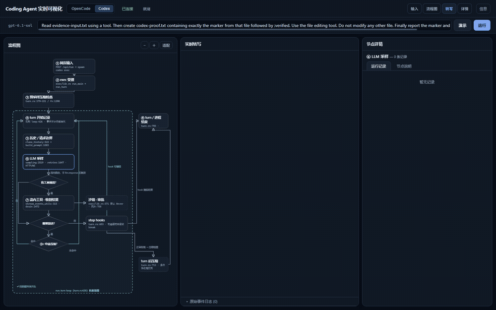

# harness-viz

**在浏览器里看清 Codex 和 OpenCode 如何完成一个编程任务。**

运行真实 CLI，查看工具调用、执行结果和客户端模型上下文；点击流程图节点，对照源码理解每一步。

[](docs/assets/demo.webm)

点击查看视频：输入任务、运行、查看工具结果和上下文。演示使用真实任务记录的加速回放，不模拟模型输出。

## 快速开始

先安装包含 npm 的 [Node.js 22+](https://nodejs.org/)。

下载或克隆此仓库后，在 `harness-viz` 文件夹打开终端，启动：

```sh
npm start
```

打开 **http://127.0.0.1:4577**。**自动安装发生在运行 `npm start` 时**：软件启动后先显示网页，在后台检查专用 Codex `0.160.0` 和 OpenCode `1.18.34`；缺少、损坏或版本不符才自动安装，需要能访问 npm registry。缓存正确时直接复用，不会每次重装。网页显示准备状态，就绪后点击顶部「输入」→「演示」→「运行」。

固定 CLI 缓存于 `.runtime/cli/`，后续启动核验并复用；全局 CLI 的安装、升级不会改变这里的运行版本。专用 OpenCode 禁止自动更新。某个 CLI 准备失败只禁用其运行入口，另一个仍可使用；顶部「信息」显示错误及专用入口。修复网络／代理或目录权限后重启 `npm start` 即可重试。

模型代理与 OpenCode 服务使用自动分配的内部端口，实际地址会打印在终端；无需手动设置或释放 `45322`／`45321`。网页入口仍是 `4577`，若该端口被占用，终端会提示检查已有实例。

首次使用官方 Codex，需登录或设置官方 API key。已有 Codex 登录态会被复制到隔离运行目录；未登录时，等专用 CLI 安装完成后在另一终端运行：

```sh
node .runtime/cli/codex/0.160.0/node_modules/@openai/codex/bin/codex.js login
```

登录后重启 `npm start`。登录命令使用 Codex 的用户认证目录；观察器仅复制认证，不修改原配置或认证文件。

默认工作目录为 `examples/demo`。

使用自己的项目：修改 [`config/settings.json`](config/settings.json) 中的 `projectPath`，然后重启。

## 能看到什么

- **流程图**：面向学习的智能体机制图，突出循环、上下文、工具、权限、执行环境和子智能体。
- **实时转写**：助手输出、工具调用、结果和权限询问。
- **调用全流程**：默认在实际事件之间展开采样前准备、工具派发／反馈、继续和退出的源码阶段，并沿流程图已有连线联动高亮；支持逐阶段前后查看。紫色源码阶段没有原生时间戳，不计为采集事件，分支文字是路线适用条件；可切换「仅采集事件」查看原始关键事件顺序。
- **上下文详情**：直接查看客户端请求、工具定义和响应，并区分证据来源。JSON 和模板预览均可选择「实际请求（无本次响应）」或「本次调用记录（含响应/关联工具反馈）」。

节点说明默认使用中文例子讲解机制，源码和运行细节可展开查看。图例区分处理、二向/多向结果、主循环与环境权限；子流程使用双边矩形。压缩的安排与执行分开，权限由各工具按需检查；工具分类和反馈明确按职责归并。逐路径核对及观测边界见 [流程核对](docs/flow-audit.md)，可编辑图源见 [coding-agent-flows.drawio](docs/assets/coding-agent-flows.drawio)。

运行准备不会直接跳到模型：常规入口经过读取历史、请求完成检查、待办选择、容量检查后采样。普通文字回答结束后通常先继续到循环头，再确认完成并退出；运行器随后转为空闲。完整机制路径与图同源，并校验每一段已有连线。请求／响应按编号关联，工具提出／执行／反馈按调用 ID 关联，时间相邻不能代替调用关系。子会话的模型与工具记录归在「管理子任务」内部，不画成父主线跳转。

查看模型请求：点击「调用模型」，切换到「运行记录」并展开请求。「下载 JSON」带缩进、只调整空白；「下载原文」保留捕获文本用于核验。两者不加入重建历史或分析字段；第三方模式下载发给上游的请求体。Codex 原生 trace 是 CLI 请求记录，不是网络抓包。

「读取历史」的运行记录提供实际模型请求中的可读清单：用户任务、已有模型输出／工具调用、工具结果回传。它说明本次模型看到了哪些可见材料，不冒充数据库完整读取或内部循环 trace；工具结果即使编码在 `user` 消息中，也不是用户又提了一条问题。增量请求与重建历史单独标注。

一次模型响应可以同时包含文字与工具调用，界面统一放在「模型响应」下。工具调用是模型提出的动作，框架工具事件记录实际状态；可按调用 ID 跳到执行顺序。「技术详情」保留完整 API 请求体、原始响应流与解析摘要；「观察器通知」中的 `llm.request/llm.response` 是发给网页的精简捕获通知，不是完整模型报文。

「模板预览」支持 Qwen3.8（开放版）、GLM5.3、**GLM5.3-Flash 独立模板**及 Kimi K3（官方 XTML 编码器的等价移植）。请求版保留生成起点、不加入本次响应；完整记录版加入本次已捕获的文字、可见思考、工具调用及按 ID 关联的反馈，并关闭新的生成起点。可生成／刷新、复制、下载；完整记录版每次刷新读取最新响应，未捕获响应或反馈不补造。来源与转换记录在「渲染详情」。模板固定在 [`src/templates/`](src/templates)，本地校验哈希，不是托管服务内部模板或 token IDs。

模板预览从本次捕获的原请求读取显式 effort，不读取当前任务输入框的选择，也不将别的模型档位静默改成模板默认值。**固定 Qwen3.8 公开模板支持 `low/medium/xhigh`，不支持 `high/max`；Kimi K3 与两份 GLM 模板支持 `low/high/max`。**例如 K3 的 `high` 可在 Kimi 模板中保留，但切到 Qwen 模板会明确提示不兼容并禁用下载，不能用 `xhigh` 冒充原请求。没有显式参数时，Jinja 模板采用其公开默认值（Qwen `xhigh`、GLM `max`），「渲染详情」标明它仅是模板默认，不代表真实服务档位。Qwen 的 `medium` 按官方模板不额外插入 effort 指令。同名档位也不保证跨模型语义等价。

技术详情的 JSON 也可选同样两种范围。请求版下载保持实际请求原文或仅调整空白；完整记录下载为 `model-call-<index>.json`，包含原请求原文、原始响应、解析结果、错误／状态及关联工具事件。**调用记录是分析封装，不是实际发送的请求体**；原请求不会被响应改写。完整模板下载为 `model-call-<index>.rendered-<template>.txt`，请求版仍为 `model-request-…`。

顶部可独立开关输入框、流程图、过程和详情；「过程」面板内切换调用全流程／转写。隐藏面板后，其余面板自动扩展。转写支持 Markdown。

### 多轮对话

一次任务结束后，顶部「输入」区域会显示 **「继续当前对话」** 复选框，默认不勾选。

- **不勾选**：下一次运行开启新会话，并按原有方式重建当前观察记录。
- **勾选**：输入下一条问题后点击「运行」，继续当前原生会话。之前的转写、模型请求／响应、工具记录和时间线保留，可逐次比较上下文变化；勾选保持有效，可继续第三、第四轮。取消勾选即可在下一次运行开启新会话。
- OpenCode 向同一个 session 追加用户消息；Codex 使用明确的当前线程 ID 执行原生 `exec resume`，不使用 `--last`。历史由原生 CLI 维护，观察器不把旧消息手工拼成新提示词。

两种框架分别记住本页的勾选状态。刷新页面会恢复服务内存中的对话记录，但勾选恢复为默认关闭。运行中暂时不能提交下一轮。时间线中的「第 N 轮」表示用户输入轮次，不是模型调用次数或内部循环次数；每轮内部仍可能有多次模型／工具往返。

## 模型设置

**模型、provider、URL、密钥、effort 和 profile 使用 OpenCode／Codex 原生配置，观察器不维护另一套模型参数。**顶部「输入」中的下拉框选择当前 CLI 已发现的模型；切换 OpenCode/Codex 后显示各自目录。未发现模型时不会伪造默认模型。

| 模式 | 配置来源 | 选择方式 |
|---|---|---|
| OpenCode | `~/.config/opencode/opencode.json/jsonc`、项目 `opencode.json/jsonc`、原生环境配置 | 原生已连接 provider 的模型目录及原生默认模型 |
| Codex | `~/.codex/config.toml` 或 `CODEX_HOME`，含项目配置和 profile | 原生 `config/read`、`model/list` 与配置中的模型/profile |

OpenCode 全局目录以 `opencode debug paths` 的 config 为准。Codex 配置／认证在私有 `.runtime/codex-home` 中加载快照，源文件保留；路径选项以原生源目录解析。OpenCode读取原生配置，仅旁路观察 SDK 推理传输，原始 URL、请求体和协议保留；Codex使用原生trace，不按模型强制转译为Anthropic。当前HTTP观测支持Anthropic Messages、OpenAI Responses和Chat Completions；其他provider的原生活动仍可见，不把未捕获报文称为完整。

### 思考强度

模型旁只显示一个 **「思考强度」** 选择框，选项为「默认、低、中、高、超高、最高」等简短档位，按所选模型原生支持的档位显示。没有强度档位的模型直接隐藏；仅提供 `none/thinking` 思考开关的模型不把开关冒充强度。「默认」沿用原生配置，选择其他档位只影响本次运行。两种框架、不同模型分别保留本页选择。

- OpenCode：读取原生模型 `variants` 中可用的强度档位，排除 `disabled` 项，运行时向原生消息接口传对应名称。
- Codex：读取原生 `model/list` 的 `supportedReasoningEfforts`，选择后通过原生 `-c model_reasoning_effort=…` 传给 CLI。原生目录未提供该模型的强度信息时不猜测档位。

演示项目的 [`examples/demo/opencode.json`](examples/demo/opencode.json) 已为 `kimi-code-plan-cn/k3-256k` 和 `kimi-code-plan-cn/k3` 设置**显式 `high`**，并提供 `low/high/max` 三个变体。项目配置合并已有原生 provider，不包含 URL、密钥或默认模型。其他项目可在自己的原生 `opencode.json/jsonc` 中配置，例如：

```json
{
  "$schema": "https://opencode.ai/config.json",
  "provider": {
    "kimi-code-plan-cn": {
      "models": {
        "k3-256k": {
          "options": { "reasoningEffort": "high" },
          "variants": {
            "low": { "reasoningEffort": "low" },
            "high": { "reasoningEffort": "high" },
            "max": { "reasoningEffort": "max" },
            "medium": { "disabled": true }
          }
        }
      }
    }
  }
}
```

这是当前 Kimi Code 的 OpenAI-compatible Chat 配置：SDK 将 `reasoningEffort` 发送为请求 JSON 的 `reasoning_effort`。Kimi Code K3 支持 `low/high/max`，省略时服务默认 `high`；这里通过配置显式发送，便于研究。其他模型／SDK 的字段、档位和默认值按各自原生接入文档设置，不把 K3 选项推广为通用标准。Codex 可在原生 TOML 顶层或 profile 中设置模型支持的 `model_reasoning_effort = "high"`，也可在网页为本次运行选择支持的档位。

保存原生配置后重启 `npm start`。选模型与档位、运行任务后，在「实际请求」JSON 中核对 `reasoning_effort`；选择 Kimi K3 预览时，显式值进入 `type="thinking-effort"` 的公开编码器片段。**API 参数不一定改变客户端 `messages[system].content`，公开 XTML 预览也不等于托管服务实际 token 输入。**未捕获的服务默认值不会被补进旧请求。参数优先级沿用原生 CLI；以最终捕获的请求为准。

来源：[Kimi Code 模型说明](https://www.kimi.com/code/docs/en/kimi-code/models.html)、[OpenCode 原生接入](https://www.kimi.com/code/docs/en/third-party-tools/opencode.html)。固定 CLI 的本地模拟验证已覆盖不选变体时的显式 `high` 和选择 `low/high/max`，以及请求版／含响应版 K3 预览；不作为真实模型思考质量的测评。

### GLM-5.3-Flash / Volcengine Ark Coding Plan

先设置原生工具使用的环境变量，不把密钥值写入观察器：

```powershell
$env:ARK_API_KEY="你的 Coding Plan API Key"
```

OpenCode 原生配置示例：

```json
{
  "$schema": "https://opencode.ai/config.json",
  "model": "volcengine-plan/glm-5.3-flash",
  "provider": {
    "volcengine-plan": {
      "npm": "@ai-sdk/openai",
      "name": "Ark Coding Plan",
      "env": ["ARK_API_KEY"],
      "options": {
        "baseURL": "https://ark.cn-beijing.volces.com/api/coding/v3",
        "apiKey": "{env:ARK_API_KEY}"
      },
      "models": {
        "glm-5.3-flash": {
          "name": "GLM-5.3-Flash", "reasoning": true, "tool_call": true,
          "limit": { "context": 1024000, "output": 65536 },
          "modalities": { "input": ["text", "image"], "output": ["text"] }
        }
      }
    }
  }
}
```

Codex 原生 `config.toml` 示例：

```toml
model = "glm-5.3-flash"
model_provider = "ark"

[model_providers.ark]
name = "Ark Coding Plan"
base_url = "https://ark.cn-beijing.volces.com/api/coding/v3"
env_key = "ARK_API_KEY"
wire_api = "responses"
requires_openai_auth = false
```

先用原生CLI验证配置，保存后重启 `npm start`，从对应下拉框选择模型。原生权限仍有效；改变模型不自动打开客户端搜索。当前 `config/settings.json` 只保留项目、扩展及工具开关：`tools.question=true` 开启单选/多选/自定义/跳过问答框；`tools.websearch="exa"` 开启OpenCode客户端Exa搜索，亦可为`"parallel"`或`false`。它与模型服务侧内置搜索分别记录。

官方Coding Plan推荐Responses API（`@ai-sdk/openai`），也支持Chat API（`@ai-sdk/openai-compatible`）及Anthropic兼容接口。**Coding Plan使用 `/api/coding/v3`，不要改为按量计费的 `/api/v3`。**Flash公开模板与GLM-5.3的固定模板不同，新增图像、视频、音频标记处理；文本/工具格式兼容不等于模板字节相同，更不能据此断言Ark服务端内部模板相同。Flash已独立固定revision和SHA256，保留MIT许可证。

来源：[火山OpenCode接入指南](https://docs.volcengine.com/docs/ark/coding-plan-personal-ai-opencode?lang=zh)、[GLM-5.3-Flash官方模型卡](https://huggingface.co/zai-org/GLM-5.3-Flash)。

## 扩展与提示词分析

`config/settings.json` 的 `extensions` 默认启用一个小型分析组合，首次启动自动安装到忽略的 `.runtime/extensions/`，之后核验并复用。也可先运行 `npm run extensions:install` 安装，运行 `npm run extensions:check` 做无模型的 MCP 初始化／工具列表及 Codex 技能发现检查。技能来源、提交和文件 Git blob 哈希，以及 npm 版本固定在 `src/extensions-lock.json`。

| 扩展 | 来源／固定版本 | 启用范围 | 观察什么 |
|---|---|---|---|
| `frontend-design` 技能 | Anthropic `anthropics/skills`，固定提交 `dbd4588…` | OpenCode、Codex | 技能目录说明、按需注入的设计指导 |
| `mcp-builder` 技能 | 同一官方固定提交，含参考文档和脚本 | OpenCode、Codex | 技能正文与参考资料的渐进加载 |
| `context7` MCP | Upstash `@upstash/context7-mcp@4.3.0` | OpenCode、Codex | 两个文档工具定义、服务说明及文档结果 |
| `dcp` 插件 | `@tarquinen/opencode-dcp@3.2.0` | 仅 OpenCode | 插件系统指导、`compress` 工具及上下文处理 |

DCP 的专用默认关闭自动更新、去重和错误清理，压缩权限设为 `ask`，低负载提醒阈值关闭到模型窗口上限，保留用户消息。它仍能提供插件指导和 `compress` 工具；只有明确使用并确认压缩时才改变保留内容。安装资源保留上游许可证，不将插件代码混入本项目源码。Codex 自带的技能另由 CLI 发现，不能把上述表格当作全部内置能力。

**修改扩展后必须重启 `npm start`**；运行中的 CLI 不会热加载这些配置。顶部「信息 → 提示词扩展」可查看配置来源并核对 OpenCode 的实际技能、MCP 状态和工具发现结果；切到 Codex 时提供原生发现检查命令，不将 OpenCode 结果当成 Codex 的证据。发现结果在同一配置的状态轮询中保留，配置变化后失效。每次捕获请求保存当时的扩展配置快照；模型详情会区分配置项、技能索引、正文标记和 MCP／插件工具定义，旧记录没有快照时不以当前配置倒推。

可用下面的只读任务触发分析（执行任务会产生正常模型费用）：

```text
OpenCode：先用 skill 加载 frontend-design，再用 Context7 查当前前端相关 API。
请给当前演示项目提出一份界面改进方案，不修改文件。
```

```text
Codex：使用 $mcp-builder，先通过 Context7 查 MCP TypeScript SDK 文档，
给出一个只读文档查询 MCP 服务的设计方案，不修改文件，不启动服务。
```

查看第一次和后续请求的 `system/instructions`、开发者消息、`tools/additional_tools`、技能加载标记及工具结果，可分析扩展如何逐步进入上下文。技能安装不等于全文已进第一条请求，MCP 的 `prompts/resources` 也不等于自动全部注入；以实际捕获 JSON 为准。要做基线对比，将 `extensions.enabled` 改为 `false` 并重启，只关闭本观察器管理的扩展，内置或用户已有能力以 CLI 的实际发现结果为准。Context7 无密钥也能发现工具；如需更高查询配额，可设置 `CONTEXT7_API_KEY`，配置只转发变量名，不写密钥值。

## 项目结构

| 目录 | 用途 |
|---|---|
| `config/` | 观察器的项目、扩展和工具开关 |
| `src/`、`public/` | 后端、版本信息与网页 |
| `examples/demo/` | 默认工作目录和演示文件 |
| `tests/`、`scripts/` | 回归测试与开发验证工具 |
| `docs/assets/` | 使用演示 GIF 与视频 |
| `.runtime/` | 固定 CLI／扩展缓存、日志、认证和验证记录，**不提交 Git** |

## 边界与开发

流程图是源码机制简图，不是逐函数追踪；客户端捕获不等于服务端最终提示词或完整内部推理，流程结束也不代表代码正确。捕获可能含敏感内容，请勿公开 `.runtime/`。

`npm test` 运行无模型回归测试；`npm run test:integration` 使用临时项目调用真实模型；`npm run test:integration -- --smoke` 验证安装／启动及本地模拟服务上的原生传输、question、显式 effort 与 K3 预览，不调用真实模型；`npm run test:browser -- ".runtime/verification/<run>"` 检查记录回放；`npm run test:browser -- --live-opencode` 只读捕获当前已完成的 OpenCode 实例，保存到忽略的 `.runtime/verification/` 并做离线浏览器回放，不提交任务或调用模型。CLI 版本和源码固定在 [`src/versions.json`](src/versions.json)，详细定位在界面节点说明中。Windows 直接执行专用二进制或 Node 启动器，不经 shell 改写提示词参数。

已保存的 OpenCode 单独回放可用 `npm run test:browser -- ".runtime/verification/<run>" --opencode-only`；`node scripts/audit-runtime-routes.mjs <run-id>` 从本地事件日志核对历史实例与机制路径的对应，不调用模型。机制展开不等于完整原生函数 trace：缺失内部判断时保留源码说明标签。

多轮本地模拟验证会分别保存 `<harness>-multiturn-events.json` 和 `<harness>-multiturn-calls.json`（harness 为 opencode 或 codex）。可用 `npm run test:browser -- ".runtime/verification/<recorded-run>" --multiturn ".runtime/verification/<smoke-run>"` 同时检查三轮回放；该选项使用固定 CLI 与本地模拟服务产生的记录，不生成公开演示素材。

[MIT License](LICENSE)。第三方模板及编码器沿用 [`src/templates/`](src/templates) 中保留的上游许可证；Jinja 引擎许可证见 [`src/vendor/jinja/LICENSE`](src/vendor/jinja/LICENSE)。
